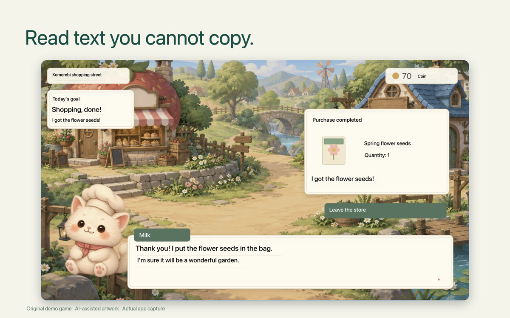

# ViewLingo — screen translation for Mac

Drag a viewfinder over dialogue in a game, subtitles in a video, or text in a PDF. ViewLingo reads the selected area and draws the translation over the original. Turn on Live to follow the next line as it appears.

[Get ViewLingo on the Mac App Store](https://apps.apple.com/app/apple-store/id6749508592?pt=128040795&ct=github&mt=12) · [Version history](https://puritysb.github.io/ViewLingo/CHANGELOG.html) · [Get support](SUPPORT.md)

🌍 Language: **English** | [한국어](docs/README-ko.md) | [日本語](docs/README-ja.md) | [简体中文](docs/README-zh-Hans.md) | [繁體中文](docs/README-zh-Hant.md) | [ไทย](docs/README-th.md) | [Español](docs/README-es.md) | [Français](docs/README-fr.md) | [Deutsch](docs/README-de.md) | [Tiếng Việt](docs/README-vi.md)

[Watch the Japanese game translation demo](https://puritysb.github.io/ViewLingo/translate-japanese-games-on-mac.html)

## Translate your first selection

1. Install ViewLingo on a Mac running macOS 15 or later. Apple silicon and Intel Macs are supported. During setup, allow Screen Recording and download the language packs you need.
2. Press `fn + Control + Option` and drag over the text. Move or resize the viewfinder to adjust what gets translated. You can change the shortcut in Settings.
3. For changing text, select **Live**. Lock the viewfinder when you want to click or scroll in the window underneath.

ViewLingo also recognizes vertical Japanese, Chinese and Korean text. The available translation languages depend on your Mac. ViewLingo is a one-time purchase. The App Store shows the price for your region.

## Where translation happens

- **Default captures and Live** use Apple Translation on your Mac and work offline after the language packs are downloaded. Text recognition happens on your Mac.
- **Regular captures** can use a connected service after you select it and allow text sharing. The service receives recognized text and the source and target languages. If it is unavailable, ViewLingo falls back to Apple Translation.
- **Translation comparison** lets you send a selected passage and any context or terms you choose, with separate consent. Supported Macs can also use Apple Private Cloud Compute for comparison. Connected providers may charge for API use.

Screenshots and saved history stay on your Mac. You can clear history or change how long it is kept. The [privacy policy](https://puritysb.github.io/ViewLingo/privacy.html) explains each connection and how to withdraw consent.

## Help and feedback

- [User guide](https://puritysb.github.io/ViewLingo/guide.html) and [FAQ](https://puritysb.github.io/ViewLingo/faq.html) for setup and troubleshooting.
- [Report a bug](https://github.com/puritysb/ViewLingo/issues/new?template=bug_report.md) or [ask a question in Discussions](https://github.com/puritysb/ViewLingo/discussions).

This repository hosts the [ViewLingo website](https://puritysb.github.io/ViewLingo/) and public support materials. The Mac app is proprietary. [License](LICENSE)

Website maintenance

The displayed product name is **ViewLingo** in every language, including wordmarks, badges and editorial video/image text. Do not transform the brand to uppercase. Technical identifiers and historical capture pixels retain their original spelling.

Website maintainers: homepages share `css/home.css` and `css/acquisition.css`; navigation and the native language selector use `css/common.css`. Keep the five localized homepage structures aligned. `assets/tokens.css` is generated from the app and must not be edited by hand. Update shared asset version queries when publishing CSS or script changes. The public URL inventory is `sitemap.xml`; publishing it does not confirm search-engine indexing.

Image thumbnails use a native dialog from `js/media.js`: Close, Escape and the backdrop return to the same page and restore focus. Media playback is exclusive, including the dynamically created hero video. FAQ answers use native disclosures; the interactive illustration has a keyboard-accessible example button and is explicitly not a performance benchmark.

Run website regression checks with `node --test tests/*.test.cjs` and `git diff --check`. Inspect desktop and mobile layouts in the browser. The game guide preserves registered incoming campaigns; otherwise its Store links use the fixed `web_game_guide` campaign label. This is aggregate App Store attribution, not app telemetry or a purchase event sent to Google.

